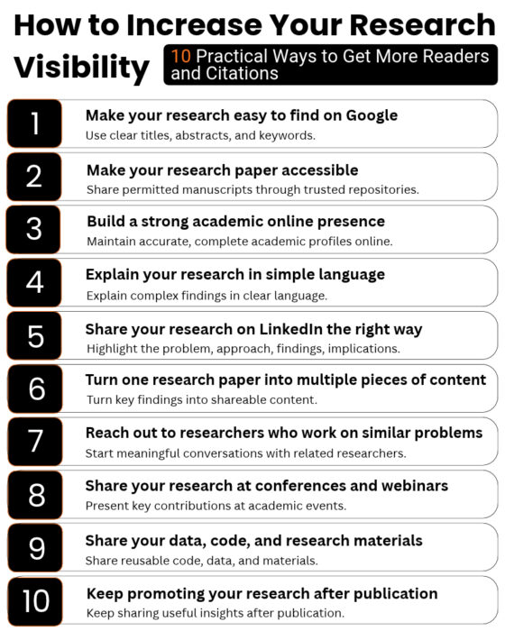

# How to increase the visibility of your research? 
  
Leave a Comment / PhD Tips / By Faheem Ullah
You spent months writing a research paper. It was finally published. But six months later, hardly anyone has read it. What went wrong? 

This is a frustrating reality for many PhD students and researchers. 

Publishing a research paper is a major achievement. However, with so many new studies appearing every day, even valuable research can struggle to attract attention. 

The problem is simple: Publishing your research does not automatically mean people will discover it. 

AI tools of the week:

victor logo  Viktor : An AI employee who helps you with your research. Get it for FREE.
sourcely logo 2  Sourcely : A tool for finding references and citations for your papers 
answerthis_logo  AnswerThis : An AI-powered platform for writing literature reviews. 
SciSpace-Logo  SciSpace : An all-in-one AI platform for supporting your research. 
Researchers often spend months preparing a manuscript but very little time helping others find and understand their work. 

Research visibility is about making your publications easier to discover, access, read, and share. Better visibility can create opportunities for collaboration, academic recognition, and potentially more citations. 

But how do you promote your research without spending hours on social media? 

Here are 10 practical strategies to increase your research visibility, even if you are an early-career researcher with a small professional network. 

How to Increase Your Research Visibility
1. Make your research easy to find on Google 
Think about how you discover research papers. 

You probably search Google Scholar or an academic database using keywords related to your research problem. 

Other researchers do exactly the same. 

If your paper has a vague title, unclear abstract, or poorly selected keywords, potential readers may struggle to find it. 

For example: 

Weak title: “A Novel Approach for Intelligent Systems” 

Better title: “Machine Learning for Detecting Cybersecurity Attacks in IoT Networks” 

The second title immediately tells readers what the research is about. 

What you should do: 

Use descriptive titles containing relevant research terms. 
Include important keywords naturally in the abstract. 
Clearly explain the research problem, methodology, and findings. 
Select keywords that reflect the actual content of your paper. 
If your paper is already published, improve its discoverability through accurate repository metadata and clear descriptions when sharing it. 

Remember: Researchers cannot read your paper if they cannot find it. 

2. Make your research paper accessible 
Imagine finding a highly relevant research paper, clicking the link, and discovering that it costs $40 to access. 

What would you do? 

Many researchers would search for an accessible alternative. 

This is why making your research available through legitimate open-access channels is important. 

Depending on your journal’s policies, you may be able to share an accepted manuscript through your university’s institutional repository. 

You can also consider publishing in reputable open-access journals when appropriate. 

What you should do: 

Check your publisher’s sharing policy and upload the permitted manuscript version to an appropriate repository. 

Include the DOI so readers can easily locate the official publication. 

For example, researchers in computer science may use arXiv when permitted, while other disciplines have their own repositories. 

Always respect publisher licenses, embargo periods, and institutional requirements. 

Remember: The easier your paper is to access, the fewer barriers potential readers face. 

3. Build a strong academic online presence 
When someone searches your name on Google, what do they find? 

Ideally, they should discover your research interests, publications, academic affiliations, and professional achievements. 

A strong academic presence helps researchers identify your work and connect it to you. 

Start with three important platforms: 

Google Scholar: Create a public profile, add your publications, and check that your citation records are accurate. 

ORCID: Register for a persistent researcher identifier that connects your scholarly contributions across institutions and publications. 

Academic website: Maintain a simple page containing your research interests, publications, projects, and contact details. 

You do not need to update every platform daily. 

A complete, accurate, and regularly maintained profile is more useful than several neglected accounts. 

Quick action: Search your own name on Google and check whether someone unfamiliar with you could easily find your publications. 

4. Explain your research in simple language 
One reason research papers receive limited attention is that their findings are difficult for non-specialists to understand. 

A technical abstract may be appropriate for a scientific journal, but it is not always suitable for LinkedIn, newsletters, or professional audiences. 

Consider this hypothetical research finding: 

“Our proposed ensemble classifier demonstrated improved predictive performance under heterogeneous data distributions.” 

Now compare it with: 

“We tested whether combining multiple machine learning models could improve predictions when datasets contain different types of information.” 

The second explanation is easier to understand without misrepresenting the research. 

What you should do: 

For every published paper, prepare a short summary answering four questions: 

What problem did you investigate? 
Why does the problem matter? 
What did you discover? 
Why should readers care? 
Aim for approximately 100–150 words. 

This summary can be reused on your academic website, in presentations, newsletters, and social media posts. 

Remember: Making research easier to understand can help it reach audiences beyond your immediate discipline. 

5. Share your research on LinkedIn the right way 
Many researchers announce their publications with a message like: 

“Happy to share that our paper has been published in XYZ Journal.” 

There is nothing wrong with this announcement, but it gives readers little reason to explore the paper. 

Instead, start with the research problem. 

For example: 

“Can AI detect cybersecurity attacks that traditional security systems miss?” 

Then explain what your study investigated and highlight one or two important findings. 

A useful research post can follow this structure: 

Problem: What challenge motivated the study? 
Approach: What did you investigate? 
Findings: What did you discover? 
Implications: Why do the findings matter? 
Finish with a link to the paper. 

Avoid exaggerating results or presenting preliminary findings as established facts. 

You do not need thousands of followers to start. A smaller audience of researchers working in your field may be more relevant than a large but unrelated audience. 

Quick action: Write one LinkedIn post explaining the most interesting finding from your latest paper. 

6. Turn one research paper into multiple pieces of content 
A research paper often contains several findings, methods, and practical insights. 

Why share it only once? 

Instead of posting the same publication announcement repeatedly, explain different aspects of the research. 

For example, one paper could become a LinkedIn post, an infographic, short blog etc. 

This approach helps different audiences discover your work in formats they prefer. 

For example, a researcher may not read your full paper immediately but may become interested after seeing a clear comparison chart. 

Every piece of content should accurately represent the original study and direct interested readers to the publication. 

Remember: You do not need to conduct new research every time you want to share something valuable. 

7. Reach out to researchers who work on similar problems 
Social media is not the only way to increase research visibility. 

Sometimes, reaching a few relevant researchers is more valuable than reaching thousands of unrelated people. 

Suppose you publish a paper on AI-based vulnerability detection. 

You could identify researchers who have recently published related work and contact them with a brief, relevant message. 

For example: 

“I recently read your study on software vulnerability prediction. Our new paper investigates a related problem using a different evaluation approach. I thought the findings might interest you.” 

Include the paper link and explain the connection. 

The purpose is to exchange knowledge, not request citations. 

Avoid sending identical messages to large numbers of researchers. 

Quick action: Identify five researchers whose work closely relates to your latest publication and consider whether a genuine research discussion would be valuable. 

8. Share your research at conferences and webinars 
Research visibility does not happen only online. 

Conferences, seminars, workshops, and webinars provide opportunities to introduce your work to relevant audiences. 

Even a short presentation can help researchers understand your contribution and remember your work. 

However, avoid turning your presentation into a summary of every section of your paper. 

Instead, focus on: 

The problem you investigated. 
Why existing approaches were insufficient. 
Your main contribution. 
The most important findings. 
Their implications and limitations. 
Include a QR code or DOI link on your final slide so interested participants can access the publication. 

You can also share your presentation afterward, provided you have permission to reuse the material. 

Remember: A good research presentation should make people interested in reading your paper. 

9. Share your data, code, and research materials 
Sometimes, researchers discover a publication because they are searching for a dataset, software implementation, or research method. 

Sharing useful research materials can therefore create additional opportunities for discovery. 

For example, if your paper introduces a machine learning approach, making the implementation available may help other researchers understand or reproduce your experiments. 

Depending on your research, you could share: 

Source code and implementation instructions. 
Datasets that can legally and ethically be released. 
Research protocols and questionnaires. 
Analysis scripts and supplementary materials. 
Platforms such as GitHub and Zenodo can support the sharing and preservation of appropriate research outputs. 

Provide clear documentation and link the materials to your published paper. 

However, never release confidential data, copyrighted materials, or participant information without appropriate permission. 

Quick action: Review your latest paper and identify whether any research materials could be shared responsibly. 

10. Keep promoting your research after publication 
One of the biggest mistakes researchers make is promoting a paper only during publication week. 

They announce it once, share the DOI, and move on. 

But research remains relevant long after publication. 

A paper published last year may become useful to researchers investigating a new problem today. 

You can revisit older publications when: 

A related research topic receives renewed attention. 
New studies build on your findings. 
You present the work at an academic event. 
You publish a follow-up study. 
Someone asks a question your paper addresses. 
For example, instead of repeatedly announcing an older paper, write a new post explaining what its findings mean in light of recent developments. 

This gives readers a fresh reason to explore the research. 

Remember: Research promotion should be an ongoing process of sharing useful knowledge, not repeatedly advertising the same publication. 

How do you know if your research is becoming more visible? 
Research visibility is not simply about collecting likes or followers. 

You should consider whether your work is reaching relevant audiences. 

Useful indicators include article downloads, repository views, citations, research-related inquiries, and opportunities for collaboration. 

You can monitor some of these through publisher dashboards, Google Scholar, repository statistics, and other scholarly information services. 

However, avoid treating citation counts as the only measure of success. 

A research paper may influence teaching, professional practice, public policy, or future research without immediately accumulating citations. 

The goal is not simply to make your research popular. It is to help the right people discover and use it. 

Frequently asked questions 
How can I increase my research visibility without social media? 
Maintain accurate academic profiles, make your papers accessible through permitted repositories, create an academic website, present at conferences, and engage with researchers working on similar topics. 

Does promoting a research paper increase citations? 
Research promotion can improve discoverability, but it does not guarantee more citations. Citations depend on the relevance, quality, accessibility, and usefulness of the research, among other factors. 

When should I start promoting my research? 
Ideally, begin planning dissemination before publication. Once your paper is published, share the findings through appropriate academic and professional channels. Continue communicating relevant insights when new opportunities arise. 

Final thoughts 
You may spend months or years producing a research paper, but your responsibility does not necessarily end when the journal publishes it. 

If your research addresses an important problem, it deserves the opportunity to reach people who can learn from it, question it, and build upon it. 

You do not need to become a social media influencer or spend hours promoting every publication. 

Start with simple actions: make your paper accessible, explain its findings clearly, share it with relevant audiences, and build meaningful academic connections. 

Most importantly, remember: 

Publishing your research makes it available. Making it visible helps people discover its value. 

Your next research paper should not simply become another publication on your academic profile. 

Give it the opportunity to reach the people who need it. 

# References
[How to increase the visibility of your research? ](https://www.smartresearcher.me/how-to-increase-the-visibility-of-your-research/)
