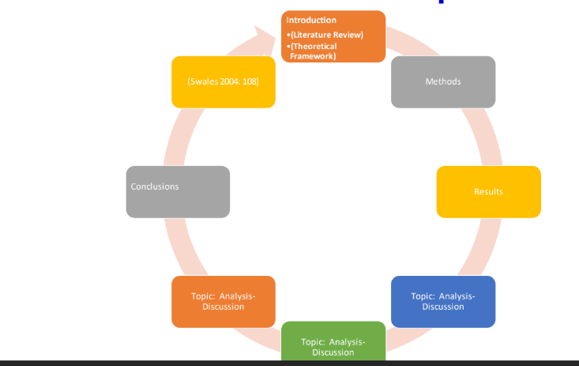
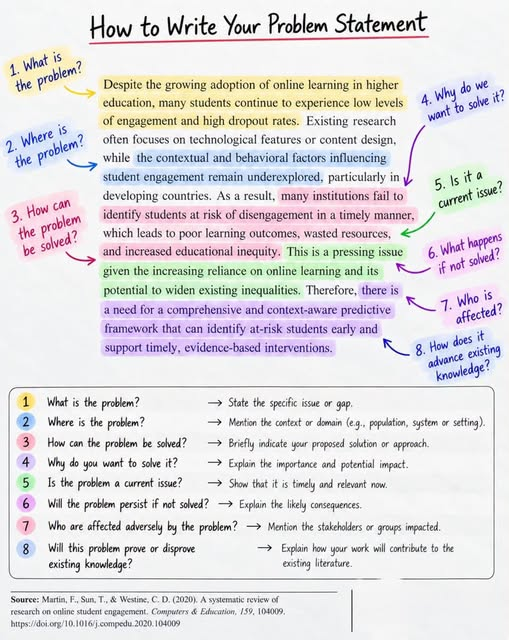

# Description:

The problem statement provides a clear and concise description of the issue that needs to be addressed. A research problem addresses an existing gap in knowledge in your field and leads to further investigations by you and other researchers. Ithe problem statement provides the “punch” or “clarity.” Without its presence, a manuscript lacks focus.All research projects should start with a clear problem statement. A problem statement is a formulation of an issue that is usually a ‘gap’ within your area.
A strong research project always begins with a clear and compelling problem statement. Whether you're writing a thesis, a dissertation, or a research article, the problem statement lays the foundation by explaining what issue exists, why it matters, and who is affected.

</a>

# 🌟 What Is a Research Problem Statement?

A research problem statement is a short, precise explanation of the issue or knowledge gap that your research aims to address. All research projects should start with a clear problem statement. A problem statement is a formulation of an issue which is usually a ‘gap' within your area. A research gap is an unanswered question, an issue, controversy, or untested hypothesis that has not yet been addressed.

The trick with research problems is working out whether they are actually worth investing the time, energy, and money to figure out. This comes with experience, or you could just read on!

Since a clear problem statement is going to form the basis of your next research project, the question is: How can I write one?

How is this done? The first step is to become familiar with the basic elements of a problem statement in effective research.

It clarifies:

- What is the problem?
- Who is facing the problem?
- Where does the problem occur?
- Why is it important to solve?
- 
Without a strong problem statement, research loses focus and purpose.

## 📑 Table of Contents  

# **🧩 Attributes of Problem Statements** 

A high-quality research problem statement should include:

✔️ Clarity and precision

Avoid vague statements and complex jargon.

✔️ Clarity and precision: 

a well-written statement that does not make sweeping generalizations and irresponsible statements, and that is not wordy;

✔️ Identification of what would be studied while avoiding the use of value-laden words and terms;

✔️Identification of an overarching question and key factors or variables;

✔️  Definition of key concepts/terms;

✔️ Articulation of study’s boundaries or parameters;

✔️ Some generalizability;

✔️  Conveyance of study’s importance, benefits, and justification (addresses the question of “so
what?“);

✔️  No use of unnecessary jargon; and  Conveyance of more than the gathering of descriptive data providing a “snapshot.
11. he problem must be challenging and original, but also potentially achievable by your team.
12. The problem must not be incremental. In other words, don't try to address a small change or advance on an existing study that leads to no new scientific insight. This could be damaging to your and your team's reputation, and will likely not lead to a meaningful publication.
13. Developing a ‘good' research problem statement, therefore, involves systematic planning and setting time-based, realistic objectives. Your problem has to be achievable
14. Not too long. One page is more than enough for a clear and effective problem statement.

✔️ Identification of the core issue

State exactly what will be studied.

✔️ Key variables or factors

Make your research direction clear.

✔️ Clear boundaries

Define the context, scope, and limitations.

✔️ Importance and justification

Explain why solving the problem matters.

✔️ Generalizability

The problem should be significant in a broader context.

✔️ Achievable and meaningful

The problem should not be trivial or impossible.

# 🪜 How to Write a Research Problem Statement (Step-by-Step)

## Step 1 — State the Problem Clearly

Complete the sentence:
“The problem is… what… for whom… where…”

Example:
The problem is that high school students in rural Pakistan struggle with mathematics due to lack of digital learning resources.

## Step 2 — Mention the Research Design

Complete the sentence:
“This (type of design) study will explore/describe/investigate… by doing what… with whom… where…”

Example:
This mixed-methods study will investigate the impact of digital learning tools by surveying and interviewing rural high school students in Sindh.

## Step 3 — Highlight the Impact

Who will benefit from your results?

Example:
The findings will help teachers and policymakers improve digital learning strategies for underserved communities.

## Step 4 — Connect to Theory

Link your research to existing theories or frameworks.

Example:
The study is grounded in Constructivist Learning Theory, which supports interactive digital learning environments.

Approx. 200–250 words total.

Stating a research problem is done by defining it within the general area of your research. This depends on your previous work and experience. It may be an area you want to move into or a topic related to what you have already worked on as a researcher. Examples could include a question in astrophysics within physics, robotics within engineering, nutrition within medicine, or marine biology within ocean and Earth science.

Once you've determined your overall area (and you'll know this already of course), it's time to drill down, decide, and define a research problem within that field.

First, your statement should identify a problem that needs to be addressed within your selected sub-area.

This will almost certainly require literature work, but the idea may arise from:

- Discussions you've had with colleagues;
- Discussions at a conference;
- A paper you've read.

Second, your problem statement should be a “good research problem.” This will require further investigation and reading as you consider “what has been done?” and “what needs to be done?”

Third, search for more information, perhaps by:

- Locating relevant books, papers and other materials;
- Evaluating the quality and authority of the information collected;
- Maintaining a regular literature review throughout the project;
- Making regular notes on background material;
- Deciding how this literature search will be carried out within the research group;
- Deciding how information gained will be disseminated to the group (e.g., via each researcher carrying out a regular literature review in their sub-area and information disseminated at group meetings or via email at regular intervals).

This process may well change or modify how your research problem is stated or formulated.

Once your research problem has been identified, research questions within the problem need to be specified.

# How long should your statement of the problem be?
Word Count: 188
Not too long. One page is more than enough for a clear and effective problem statement.

# 🧪 Example of a Complete Research Problem Statement (Sample)

Topic: Impact of Social Media Use on University Students’ Academic Performance

Problem Statement Example:
University students increasingly use social media platforms for communication, entertainment, and academic purposes. However, excessive or unstructured use of these platforms may negatively affect academic performance. The problem is that undergraduate students at XYZ University in Pakistan are experiencing academic performance challenges due to high social media usage, yet there is limited empirical evidence showing how different usage patterns influence learning outcomes.

This quantitative descriptive study will examine the relationship between social media usage frequency, usage purpose, and the academic performance of undergraduate students at XYZ University. Data will be collected using a structured questionnaire distributed across five departments.

The results of this study will help educators and administrators develop stronger digital literacy programs and promote healthier social media habits. This research is supported by Time Management Theory, which suggests that how students allocate their time significantly affects academic success.

## ❓ Good Research Questions Based on the Above Problem

How frequently do undergraduate students use social media daily?

What types of activities do students engage in on social media?

What is the relationship between social media usage and academic performance?

Which usage patterns most strongly influence academic achievement?

# 🔍 Another Example (Very Simple One)

Topic: Water Pollution Awareness

Problem:
Residents of Karachi face increased waterborne diseases, but awareness about clean water practices is low.

Research Question:
What factors influence awareness of safe water practices among Karachi residents?

Design:
A qualitative study using interviews with 30 households.

Impact:
Will guide public health departments in designing better awareness campaigns.

# Research questions within your problem

- The first stage of writing your research problem statement involves formulating your questions in a meaningful way. In the context of important questions, we are looking for things that many readers across different disciplines find to be interesting. But at the same time, set your question within your field.
- Thus, once a research problem has been established, several questions can be written down. These questions should specify exactly what needs to be determined to address the problem.
- These questions should also be specific enough that they can be answered using appropriate available research methods - or methods that could be made available to the research group (e.g. by buying or borrowing equipment)
- These questions should require complex in-depth investigation, analysis, and argument. They should not be simple enough that they can be answered easily with well-established facts or yes/no answers.
- All research questions should be focused, specific, appropriately complex, and relevant to the overall aims of the project.

# Examples of questions and next steps

- How do government regulations prevent companies from polluting water systems?
- What factors have influenced population growth in the fastest growing countries?
- What methods and procedures can be used to understand, and hence control, fundamental chemical processes that occur in flames?

- How can measurement protocols used in mass spectrometry in a university research laboratory be developed and standardized to enable direct comparison with related measurements in a government laboratory?
Once the problem and questions have been identified, the resources required to carry out the research will need to be assessed. This will involve:
- Identifying the equipment needed. Find out what is available and what needs to be purchased.Assessing which consumables (e.g., chemicals) are needed for the project, and determining if they can be obtained on a regular basis (i.e., in the right quantities at the appropriate times).
- 
Identifying the software, data-analyses and other computer support needed. Assess what needs to be purchased. Assessing what laboratory and office space is needed. And if more is required, discuss this with the relevant laboratory manager.

Identifying what support for travel is needed for the group, as well as what resources are required for the group to attend relevant conferences and training of group personnel.

# Reviewer Comments

- The problem descriptions describe the waterborne issues rather than the technical research issues

# Final thoughts

Defining and writing a clear statement of a problem as the basis of a project is the first - and most important - step in any research. The tips and ideas in this article will help you clearly identify the purpose of the research you are developing.

A clear research problem statement will likely form the skeleton of the Introduction of your final article. If you are able to clearly direct your reader (the most important person in the publishing process) to an important and interesting question, they will likely stay engaged, and use and cite your article in the future.

### References
-[How to Write a Statement of the Problem for Your Research Proposal](https://www.aje.com/arc/how-to-write-a-statement-of-the-problem)

-[How to Write an Effective Research Problem Statement (With Example)](https://chatgpt.com/c/6932ad62-ad08-8320-96d4-7a107b2c5eca)

️

